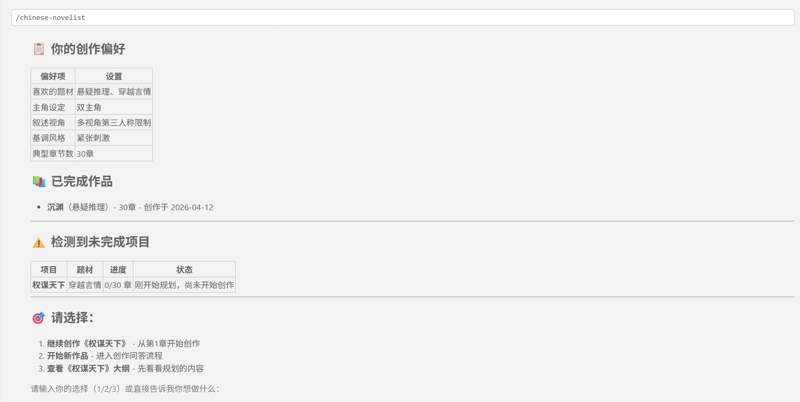

<div align="center">

# english-novelist skill

### Let the AI write a complete English novel for you

An English fork of the chinese-novelist skill (MIT, original by PenglongHuang).

[](https://github.com/PenglongHuang/chinese-novelist-skill/releases)
[](https://claude.com/claude-code)
[](LICENSE)

> **v1.0 English release** — a full English re-render of the workflow: three-layer progressive Q&A, preference memory, interrupted-resume, three writing modes, and auto-validation & repair.

</div>


## Why use this?

The hardest part of writing a novel is **finishing it**. This skill exists to solve that exact problem:

- **Smart Q&A** - a three-layer progressive questionnaire that supports fast-skip and random generation
- **Preference memory** - learns your taste across sessions, so your next project starts closer to the mark
- **Interrupted-resume** - did the session break? It detects the interruption and continues from where it left off
- **Multiple writing modes** - serial / subagent-parallel / Agent Teams, picked to fit the job
- **Auto-validation** - auto-checks word count and coherence when done, and rewrites whatever fails
- **Every chapter lands** - open with a strong hook, close on a cliffhanger

## Quick Start

Install the skill: `npx skills add PenglongHuang/english-novelist-skill`

Run the prompt: `use english-novelist to write me a novel`

## Workflow At a Glance

<table>
  <tr>
    <td align="center"><b>Phase 1 — Interactive Q&A</b></td>
    <td align="center"><b>Phase 2 — Planning & Confirmation</b></td>
  </tr>
  <tr>
    <td></td>
    <td></td>
  </tr>
  <tr>
    <td align="center"><b>Phase 3 — Autonomous Writing</b></td>
    <td align="center"><b>Phase 4 — Finished Output</b></td>
  </tr>
  <tr>
    <td></td>
    <td></td>
  </tr>
</table>


## Writing Memory

After every project, the skill automatically learns your preferences: the genres you favor, your narrative style, your chapter-count leanings, prose density, and more. The next time you write, it applies your habits directly, sparing you the repeat questioning.

<p align="center">
  
</p>


## Core Workflow

```
User → ┌─────────────┐    ┌──────────────────────┐    ┌──────────────┐
        │ Phase 0     │ →  │ Phase 1              │ →  │ Phase 2      │
        │ Init        │    │ Three-Layer Q&A      │    │ Plan + OK    │
        │ ·Preferences│    │ L1: Core (required)  │    │ ·Outline     │
        │ ·Resume     │    │ L2: Custom (optional)│    │ ·Characters  │
        └─────────────┘    └──────────────────────┘    │ ·Plan JSON   │
                                                      └──────┬───────┘
                                                             ↓
                                             ┌───────────────────────────┐
                                             │ Phase 2.5 Mode Selection  │
                                             │ Serial / Parallel / Teams │
                                             └─────────┬─────────────────┘
                                                       ↓
       ┌──────────────────────────────────────────────────────────────┐
       │ Phase 3 Autonomous Writing (fully auto, no confirmation)     │
       │ Per chapter: pre-write analysis → draft → de-AI polish →     │
       │ word count check                                             │
       └──────────────────────────────────────────────────────────────┘
                            ↓
       ┌──────────────────────────────────────────────────────────────┐
       │ Phase 4 Auto-Validation & Repair (fully auto)                │
       │ word count → coherence check → auto-rewrite fails (max 3)    │
       └──────────────────────────────────────────────────────────────┘
                            ↓
                       Novel complete
```

### Phase 0: Initialization

Automatically loads the user's preferences (`user-preferences.json`), detects any unfinished project to resume, and shows a personalized welcome.

### Phase 1: Three-Layer Progressive Q&A

**Layer 1 — Core positioning (required, 3 questions)**: genre & creative hook, protagonist setup, core conflict.

**Layer 2 — Deep customization (optional, 5 questions)**: worldbuilding, narrative point of view, core theme, target readership, chapter count.

> Every question supports random generation; you can also just say "skip" or "use all defaults".

```
Q1: Genre & creative hook
   ○ Mystery/Thriller   ○ Contemporary Romance   ○ Fantasy               ○ Science Fiction
   ○ Action/Adventure   ○ Historical             ○ Urban/Literary        ○ Random

Q2: Protagonist setup
   ○ Male lead   ○ Female lead   ○ Dual protagonists   ○ Ensemble cast

Q3: Core conflict
   ○ Life and death   ○ Uncovering the truth   ○ Revenge     ○ Growth and triumph
   ○ Love against odds ○ Power struggle        ○ Protection/guardianship

   ... Layer 2 lets you customize further, or jump straight to planning ...
```

### Phase 2: Planning + Confirmation

The AI generates the outline (a 7-column chapter plan), character profiles, and a writing-plan JSON, then presents them for your confirmation:

```
━━━━━━━━━━━━━━━━━━━━━━━━━━━━━━━━━━
Planning complete! Please confirm:

Basic details
  Genre: Mystery      |  Lead: male detective  |  Conflict: uncovering the truth
  Chapters: 20        |  POV: first person     |  Tone: tense, restrained

Chapter plan (first 5)
  Ch. 1: Midnight Call - a mysterious phone call...
  Ch. 2: The First Body - a locked-room murder...
  ...

Main characters
  Protagonist: Alex Reed - veteran detective, calm and sharp
  Antagonist: Marcus Vane - high-IQ criminal
  Supporting: Dr. Lena Cho - forensic expert

━━━━━━━━━━━━━━━━━━━━━━━━━━━━━━━━━━
Reply "confirm" → choose a writing mode → start immediately
```

### Phase 2.5: Writing-Mode Selection

| Mode | Description | When to use |
|------|-------------|-------------|
| **Serial** | Main agent writes chapter by chapter; stable and dependable | Recommended default |
| **Subagent-parallel** | Several subagents draft chapters in parallel batches | When speed matters |
| **Agent Teams** | Claude Code multi-agent collaboration | Large, sprawling novels |

### Phase 3: Autonomous Writing

Once confirmed, it enters fully automated writing mode — no further confirmation needed. You can step away from the keyboard and wait for it to finish.

Each chapter strictly follows: pre-write analysis → draft → de-AI polish → word-count check → update the running summary.

```
Chapter 1 complete (3,247 words)
Chapter 2 complete (3,582 words)
Chapter 3 complete (3,412 words)
...
```

### Phase 4: Auto-Validation

After the draft is done, it automatically checks word-count targets and coherence, and auto-rewrites any chapter that fails (up to 3 rounds).

---

## Output Sample

```
english-novelist/
├── user-preferences.json             # user preferences (shared across projects)
└── 20260412-143000-Midnight-Train/
    ├── 01-outline.md                 # story overview, chapter plan (7-column template) + setting glossary
    ├── 00-character-profiles.md      # protagonist, antagonist, supporting cast
    ├── 02-writing-plan.json          # machine-readable writing plan (v2)
    ├── 03-style-baseline.md          # style fingerprint, baseline passages, no-AI-flavor blacklist
    ├── 99-chapter-summaries.md       # per-chapter summaries (for continuity, appended as you go)
    ├── Chapter-01-Last-Train.md
    ├── Chapter-02-Vanished-Passengers.md
    └── ...
```

---

## Golden Rules

| Rule | Meaning |
|------|---------|
| **Show, Don't Tell** | Dramatize through action and dialogue; don't state outright |
| **Conflict-driven plot** | Every chapter must bring conflict or a turning point |
| **Suspense that bridges chapters** | Every chapter must end on a hook |
| **Open with a strong hook** | The first 20% must be gripping |

---

## Installation

Place this directory in Claude Code's skills directory:

```
~/.claude/skills/english-novelist/
```

Or install it through Claude Code's skill management interface.

---

## Built-in References

### Flow documents (`references/flows/`)

| File | Contents |
|------|----------|
| `phase0-initialization.md` | Phase 0: initialization & preference loading |
| `phase1-layer1-core.md` | Phase 1 Layer 1: core positioning Q&A (Q1–Q3) |
| `phase1-layer2-customize.md` | Phase 1 Layer 2: deep customization Q&A |
| `phase2-planning.md` | Phase 2: planning & writing-plan generation |
| `phase3-writing.md` | Phase 3: autonomous writing (three writing modes) |
| `phase4-validation.md` | Phase 4: auto-validation & repair |
| `shared-infrastructure.md` | Shared mechanisms (preference system, golden rules, word-count script) |

### Writing guides (`references/guides/`)

| File | Contents |
|------|----------|
| `chapter-guide.md` | Chapter-writing guide (openings, English craft techniques, continuity, quality checks) |
| `hook-techniques.md` | Suspense & cliffhanger techniques (13 types of closing hooks) |
| `character-building.md` | Character-craft techniques (focused on shaping characters through the prose) |
| `dialogue-writing.md` | Dialogue-writing standards (pacing, subtext, power dynamics) |
| `plot-structures.md` | Plot-structure templates |
| `content-expansion.md` | Content-expansion techniques (genre-specific strategies, worked before/after examples) |
| `outline-template.md` | Outline template (7-column chapter plan) |
| `character-template.md` | Character-profile template |
| `chapter-template.md` | Chapter-file template |

---

## Version & Roadmap

- **Changelog**: [Releases](https://github.com/PenglongHuang/chinese-novelist-skill/releases) — full notes for each release
- **Roadmap**: [ROADMAP.md](ROADMAP.md) — done / in-progress / planned

---

## Discussion

- [GitHub Discussions](https://github.com/PenglongHuang/chinese-novelist-skill/discussions) — usage tips, finished works, feature ideas
- [Issues](https://github.com/PenglongHuang/chinese-novelist-skill/issues) — feedback and bug reports

## License

[MIT](LICENSE)